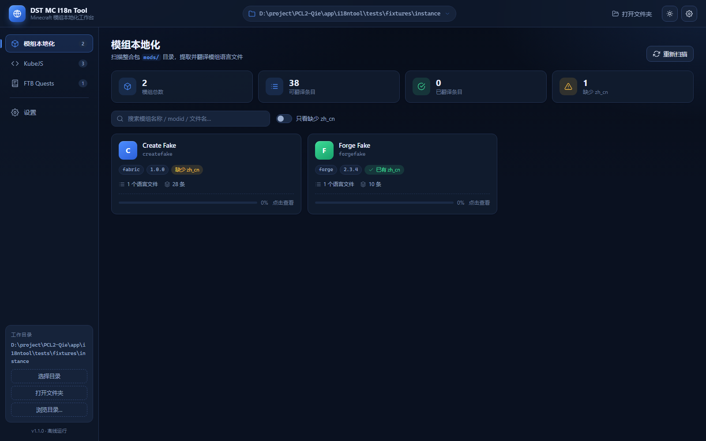
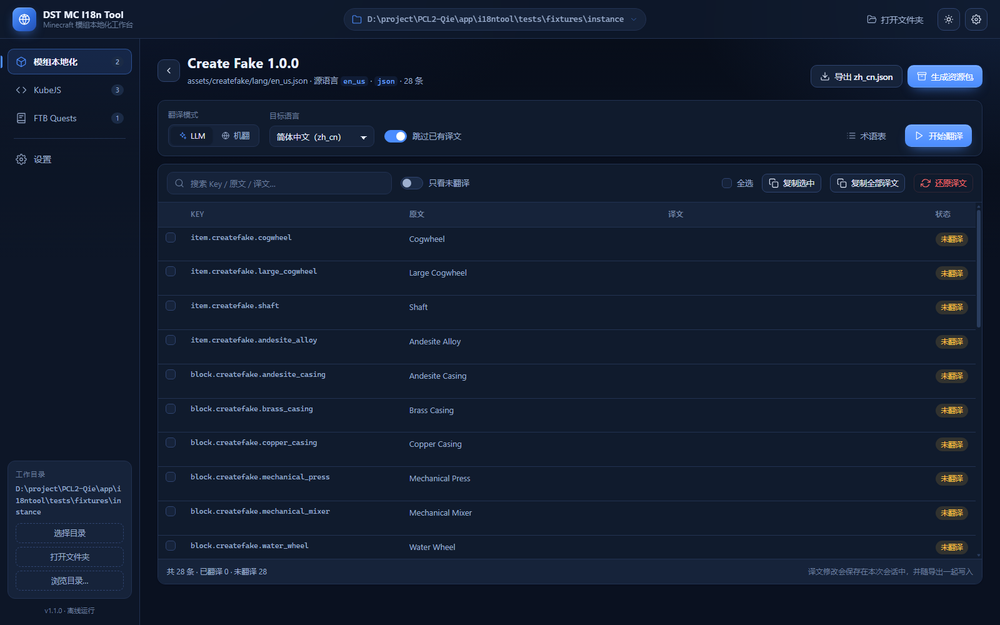
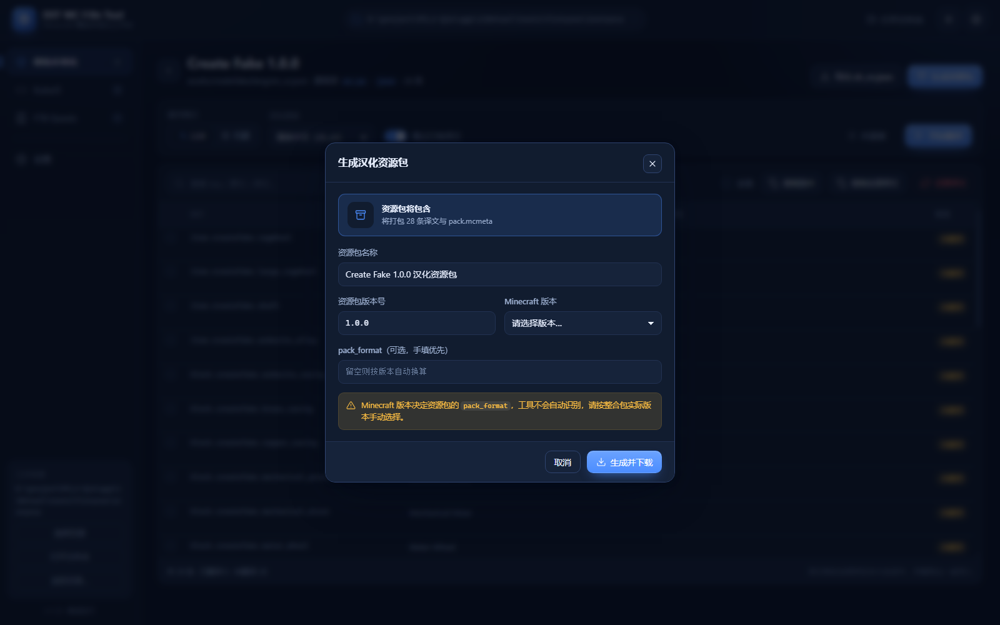
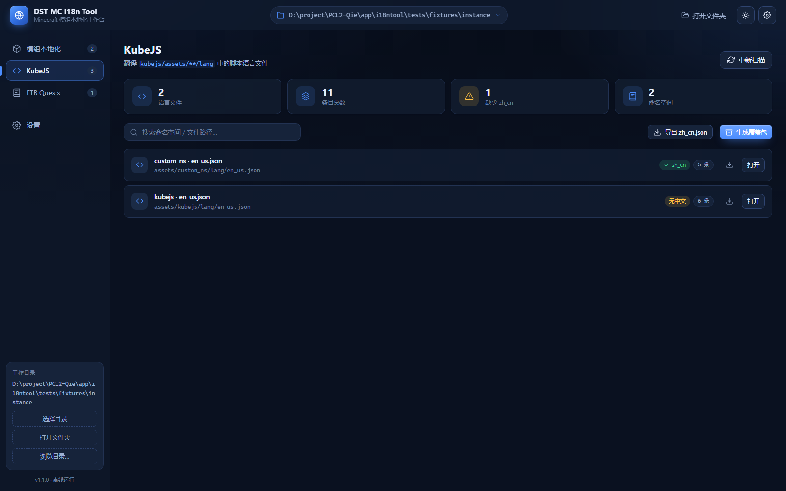
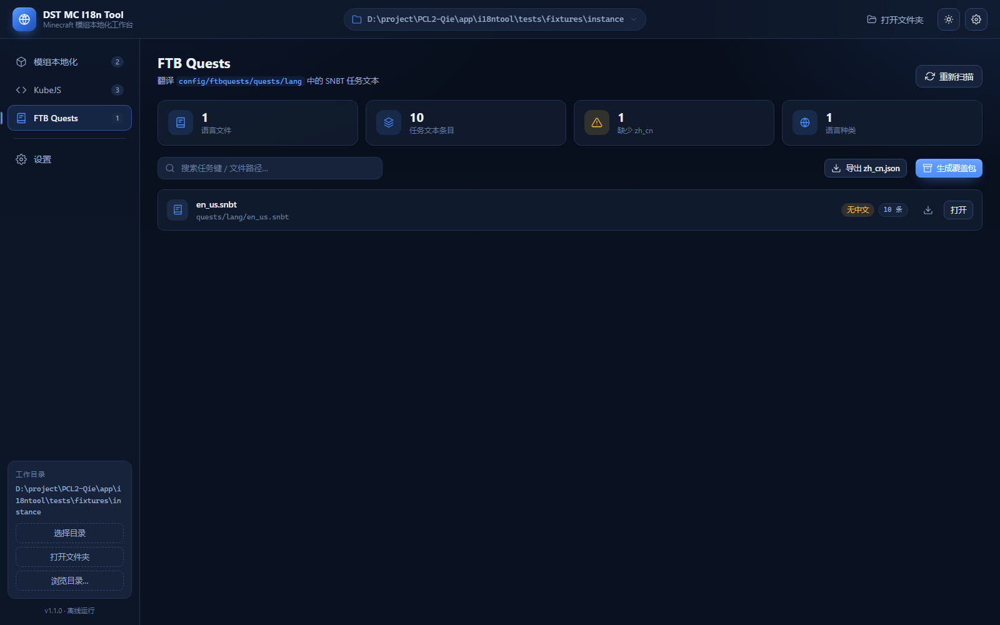
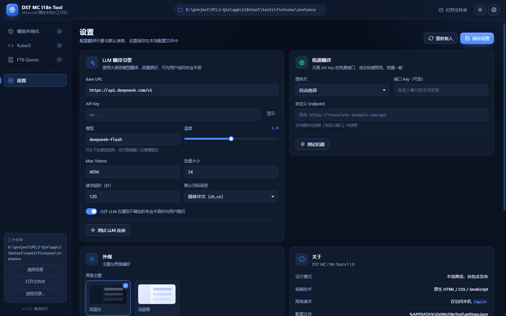
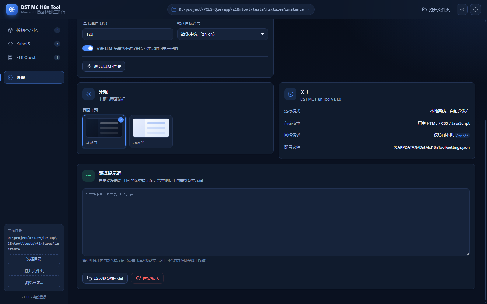

# DST MC I18n Tool

> 一个离线优先、双击即用的 Minecraft 整合包汉化工具：扫描整合包里的模组、KubeJS 与 FTB Quests 语言文件，
> 借助 DeepSeek（或任意 OpenAI 兼容接口）/ 机器翻译批量生成 `zh_cn` 译文，并一键打包成资源包或覆盖包。

- 自包含发布（普通多文件打包，**不做单文件、不做自解压**）：目标机器无需安装 .NET 运行时，启动时也不会往临时目录解压；
- 前端界面完全内嵌在程序集里，**没有任何第三方库、CDN 或外网请求**，断网也能打开界面；
- 服务只监听 `127.0.0.1`，不会暴露到局域网；
- 只在你点击「开始翻译」时才访问你配置的翻译接口，其余操作全部本地完成。

> 当前版本：**v1.1.0**（新增异步扫描进度 / 可编辑提示词 / 一键还原 / 覆盖包免版本号）



---

## 目录

- [功能](#功能)
- [快速开始](#快速开始)
- [构建](#构建)
- [运行参数](#运行参数)
- [界面与工作流](#界面与工作流)
- [DeepSeek / 翻译接口配置](#deepseek--翻译接口配置)
- [目录结构](#目录结构)
- [测试](#测试)
- [常见问题（FAQ）](#常见问题faq)
- [许可证](#许可证)

---

## 功能

### 1. 工作目录扫描

选择一个整合包目录（`.minecraft`、版本隔离目录或整合包根目录均可），程序会自动识别：

| 类型 | 识别方式 |
| --- | --- |
| 模组 | `mods/*.jar`，以及解压成文件夹的 mod（`mods/<名字>/assets/...`），读取 `fabric.mod.json` / `META-INF/mods.toml` / `quilt.mod.json` 获取 modid、名称、版本、加载器 |
| KubeJS | `kubejs/assets/<namespace>/lang/*.json` |
| FTB Quests | `config/ftbquests/**/*.snbt`（也兼容 `kubejs/config/ftbquests`） |
| 版本信息 | 目录下的 `version.json` / `instance.json` / `mmc-pack.json` |

扫描是**异步**的：选择目录后会先做合法性校验（不是整合包目录会直接提示，并列出候选目录），
校验通过立刻更新界面上的路径，然后显示带进度条、当前文件名、已发现模组数的解析进度。
解析期间可以随时取消；想换目录必须先取消，取消后按钮才会解锁。

扫描结果会给出 `mods`、`kubejs`、`config` 是否找到、每个 mod 的语言文件列表、
条目数以及是否已经存在 `zh_cn` 译文。损坏的 jar 不会让整个扫描失败，只会记一条警告。

如果选中的是启动器根目录（下面按版本分目录），程序会列出候选项，提示你选择具体的版本隔离目录。

### 2. 键值表编辑

每个语言文件展开成三列表格：**Key / 原文 / 译文**。

- 译文可直接编辑，支持搜索过滤、只看未翻译；
- 保留原有 `%s`、`%1$s`、`§a` 颜色码、`\n` 换行等格式占位符，
  翻译时会先把它们替换成标记，翻完再还原，避免译文把占位符弄丢；
- 若语言文件已有 `zh_cn` 版本，会自动载入已有译文，可选择「跳过已有译文」。

### 3. 批量翻译

两种模式：

- **LLM（推荐）**：调用 DeepSeek 或任意 OpenAI 兼容的 `/chat/completions` 接口，
  按批次翻译并保持 JSON 键值结构；术语表会作为约束传给模型；
- **机器翻译**：走 `auto` / `google` / `bing` / `custom` 提供方，
  不需要 API Key 也能用，适合先出一版粗翻再人工润色。

翻译是后台任务：界面显示进度条、逐条状态，可随时取消。
开启「允许 LLM 向用户提问」后，遇到专业术语模型会反问你，弹窗作答后继续翻译。

### 4. 导出

| 产物 | 说明 |
| --- | --- |
| `zh_cn.json` | 单个语言文件的译文，UTF-8 无 BOM，中文不转义 |
| 汉化资源包（zip） | 含 `pack.mcmeta`、`pack.png` 与 `assets/<namespace>/lang/zh_cn.json`，丢进 `resourcepacks/` 即可使用 |
| KubeJS 覆盖包（zip） | 就是一个 `kubejs/` 文件夹的压缩包，解压到整合包根目录直接覆盖；**不需要填版本号** |
| FTB Quests 覆盖包（zip） | `config/ftbquests/` 的压缩包，解压到整合包根目录覆盖；**不需要填版本号** |
| 直接写回工作目录 | 把译文原地写入整合包（可选择是否覆盖已有文件） |

资源包的 `pack_format` 由你选择的 Minecraft 版本决定（**不会自动猜版本**），
也可以直接手填 `pack_format` 数值。

覆盖包默认导出**全部**语言文件（不是只导出你当前打开的那个），内容为「原文全量 + 磁盘已有 zh_cn + 本次译文」的完整表，
所以解压覆盖后不会出现“只翻译了几条、其余变成 key”的半截语言文件。

### 5. 一键还原

键值表页与翻译任务面板都提供「还原译文 / 全部还原」：
清空本会话里对该文件做的所有译文修改，回到文件里已有的 `zh_cn`（若有）或空。
用于翻译效果不理想时快速重来，不需要重新打开文件。

---

## 快速开始

1. 从 Releases 下载 `DST-MC-I18n-Tool.exe`；
2. 双击运行（或命令行带参数运行，见下）；
3. 浏览器会自动打开 `http://127.0.0.1:<端口>/`；
4. 点顶部「打开文件夹」选择整合包目录；
5. 在「模组本地化 / KubeJS / FTB Quests」页选择语言文件，翻译、编辑、导出。

第一次使用建议先到「设置」里填好 DeepSeek API Key 并点「测试 LLM 连接」。

---

## 构建

环境要求：

- .NET SDK **10.0** 或更高（本仓库使用 `net10.0` 目标框架）；
- Windows x64（发布运行时标识符为 `win-x64`）。

一条命令发布到 `dist/`：

```powershell
# PowerShell
.\build.ps1
```

```bash
# git-bash / WSL / Linux 上的 bash（产物仍是 win-x64 exe）
./build.sh
```

两个脚本等价于：

```bash
dotnet publish DstMcI18nTool.csproj -c Release -r win-x64 -o dist \
    -p:SelfContained=true -p:PublishSingleFile=false
```

发布完成后把 **整个 `dist/` 目录**一起分发（约 334 个文件、107 MB），双击其中的 `DST-MC-I18n-Tool.exe` 即可运行。
前端已作为 EmbeddedResource 打进程序集，所以 `dist` 里不需要带 `wwwroot`。

> ⚠️ 只拷 exe 是**不能运行**的——依赖 dll 都在同目录。打包分发时请压缩整个 `dist` 目录。
构建脚本会先清空 `dist/`，避免残留旧文件。

> 只想本机调试时，可以直接 `dotnet run --project DstMcI18nTool.csproj -- --path <整合包> --no-browser`。

---

## 运行参数

```
DST-MC-I18n-Tool.exe [--path <minecraft-dir>] [--port <port>] [--no-browser]
```

| 参数 | 说明 |
| --- | --- |
| `--path <dir>` | 启动时直接打开的 Minecraft / 整合包目录。省略时可在网页里选择。 |
| `--port <port>` | 监听端口，1–65535。省略时随机挑一个空闲端口。 |
| `--no-browser` | 不自动打开浏览器（服务器、脚本、自动化测试时使用）。 |
| `-h` / `--help` | 显示帮助。 |

也支持 `--path=<dir>`、`--port=<port>` 的等号写法。

服务只绑定 `127.0.0.1`。程序启动后会在控制台打印实际使用的地址；
如果随机端口被占用或你想固定地址，用 `--port` 指定即可。

---

## 界面与工作流

| 页面 | 作用 |
| --- | --- |
| 模组本地化 | mod 卡片列表 → 选择语言文件 → 键值表 → 翻译 / 导出资源包 |
| KubeJS | 按命名空间列出 KubeJS 语言文件 → 键值表 → 导出 `zh_cn.json` / 覆盖包 |
| FTB Quests | 列出 SNBT 语言文件 → 键值表 → 导出 `zh_cn.json` / 覆盖包 |
| 设置 | 翻译接口、模型、**提示词**、术语、目标语言、批量大小、超时等 |

典型流程：打开目录（异步解析，可取消）→ 选文件 → （可选）填术语表 → 开始翻译 → 校对 / 一键还原 → 导出资源包 / 覆盖包。

| 键值表 | 生成资源包 |
| --- | --- |
|  |  |

| KubeJS | FTB Quests |
| --- | --- |
|  |  |

| 设置 | 翻译提示词 |
| --- | --- |
|  |  |

---

## DeepSeek / 翻译接口配置

「设置」页中与 LLM 相关的字段：

| 字段 | 默认值 | 说明 |
| --- | --- | --- |
| LLM Base URL | `https://api.deepseek.com/v1` | OpenAI 兼容接口的 base url（程序会自动拼 `/chat/completions`） |
| API Key | 空 | 在 <https://platform.deepseek.com/api_keys> 申请；**只保存在本机** |
| 模型 | `deepseek-flash` | 下拉候选 `deepseek-flash` / `deepseek-v4-pro`，也可手填任意兼容模型名 |
| 温度 | `1` | 0–2；想更稳定可调到 0.3–0.5 |
| maxTokens | `4096` | 单次请求输出上限 |
| 批量大小 | `24` | 一次请求提交多少条，条目多时不要调太大 |
| 请求超时 | `120` 秒 | 网络慢时调大 |
| 目标语言 | `zh_cn` | 生成的资源包语言代码 |
| 允许 LLM 向用户提问 | 开 | 关闭后遇到术语直接按模型判断翻译，不再弹窗 |
| 翻译提示词 | 内置默认 | 可整段改写；支持 `{{targetLanguage}}` / `{{glossary}}` / `{{askUser}}` 占位符，留空即用默认 |

> 默认提示词已包含“**如果此键值对是在定义物品 ID、索引其他组件这类非文本内容时，不予翻译、原样返回**”的约束，
> 避免把 `create:cogwheel` 之类的注册名当成普通文本翻译掉。

安全说明：

- API Key **不会**回传给浏览器（接口里 `llmApiKey` 永远返回空字符串，只返回 `llmApiKeySet: boolean`）；
- 配置文件位置：`%APPDATA%\DstMcI18nTool\settings.json`（设置页底部会显示真实路径）；
- 想清空 Key，直接删除该配置文件或手动编辑。

机器翻译提供方：

- `auto`：自动选择可用通道；
- `google` / `bing`：内置公共通道，无需 Key（可能受网络环境影响）；
- `custom`：填自己的 endpoint 与 API Key。

---

## 目录结构

```
app/i18ntool/
├── DstMcI18nTool.csproj      # 项目文件（net10.0, 自包含多文件发布, 前端内嵌）
├── build.ps1                 # 一条命令发布到 dist/（PowerShell）
├── build.sh                  # 一条命令发布到 dist/（bash）
├── README.md                 # 本文档
├── .gitignore
├── docs/
│   └── API.md                # 前后端 HTTP API 契约
├── src/
│   ├── Program.cs            # 应用入口（Kestrel 启动 / 参数 / 随机端口）
│   ├── Api.cs                # 全部 HTTP 接口与静态资源路由
│   ├── Assets.cs             # 内嵌前端资源加载 + 系统文件夹选择框
│   ├── Core/
│   │   ├── AppOptions.cs     # 命令行参数解析与 --help 文本
│   │   ├── Dtos.cs           # 接口请求 / 响应 DTO
│   │   ├── JarReader.cs      # 不解压读取 jar 内条目与 mod 元数据
│   │   ├── JsonUtil.cs       # JSON 解析、扁平化、写回
│   │   ├── Models.cs         # 全部领域模型
│   │   ├── PromptDefaults.cs # 内置翻译提示词与占位符渲染
│   │   ├── SettingsStore.cs  # 全局设置持久化（%APPDATA%）
│   │   ├── Snbt.cs           # 最小 SNBT 读写（FTB Quests）
│   │   └── WorkspaceScanner.cs # 整合包扫描
│   └── Services/
│       ├── DocumentService.cs   # 语言文件 -> 键值表
│       ├── Exporters.cs         # 资源包 / 覆盖包 / json 生成
│       ├── ExportService.cs     # 导出编排：合并完整语言表、写回磁盘
│       ├── LlmClient.cs         # OpenAI 兼容接口客户端
│       ├── MachineTranslator.cs # 机器翻译
│       ├── Placeholders.cs      # 占位符保护
│       ├── TranslationEngine.cs # 批量翻译任务调度 + 术语提问
│       └── WorkspaceSession.cs  # 当前打开的目录
├── wwwroot/                  # 前端（纯原生 HTML/CSS/JS，构建时内嵌进 exe）
│   ├── index.html
│   ├── style.css
│   └── app.js
└── tests/
    ├── make_fixtures.py      # 生成假整合包测试夹具（可重复执行）
    ├── e2e.py                # 端到端验收脚本（标准库 urllib，输出 PASS/FAIL）
    ├── fixtures/instance/    # 生成出来的测试用假 .minecraft 目录
    └── ExportHarness/        # 导出服务的独立自测控制台工程
```

运行时会在 exe 同级目录或 `%APPDATA%\DstMcI18nTool\` 下产生设置文件；
除此之外不会写系统目录。

---

## 测试

### 生成测试夹具

```bash
python tests/make_fixtures.py
```

生成 `tests/fixtures/instance`（一个假的整合包：Fabric/Forge mod、损坏 jar、KubeJS、FTB Quests、version.json）。
脚本只依赖标准库，**可重复执行**：每次先清空再生成，jar 内时间戳固定，产物字节级一致。
用 `--out <dir>` 可指定其他输出目录。

### 端到端验收

```bash
python tests/e2e.py
python tests/e2e.py --exe "D:/build/DST-MC-I18n-Tool.exe" --verbose
```

脚本会用 `--path <夹具> --port <随机端口> --no-browser` 启动发布后的 exe，
轮询 `/api/health` 直到就绪，然后验证工作目录扫描、三类文档读取、四种导出产物（含 zip 结构、
`pack.mcmeta` 的 `pack_format`、JSON 是否为 UTF-8 无 BOM）以及错误分支，
最后关闭进程并打印 PASS / FAIL 汇总。退出码：`0` 全通过、`1` 有失败、`2` 无法开始测试。

> e2e 需要先有发布产物。exe 未构建时脚本会直接提示并退出，不会自己去 `dotnet publish`。

---

## 常见问题（FAQ）

### 双击后浏览器没打开 / 页面打不开

- 程序默认会自动打开浏览器；若被安全软件拦截或想手动打开，看控制台打印的地址（形如 `http://127.0.0.1:51234/`）手动访问；
- 用 `--no-browser` 启动时不会自动打开，这是预期行为；
- 确认程序没有被防火墙/杀软完全阻止（见下一条）。

### 端口被占用

程序默认随机选空闲端口，一般不会冲突。若你用 `--port` 固定了端口而它被占用，
换一个端口即可（例如 `--port 18080`）。想确认端口是否被占用：

```powershell
Get-NetTCPConnection -LocalPort 18080 -ErrorAction SilentlyContinue
```

### 杀毒软件误报 / exe 被删

本程序**不是**单文件自解压包：`dist/` 里就是普通的 exe + 一堆依赖 dll，启动时不会往临时目录解压，
因此比单文件自解压版本少了一类常见的启发式误报来源。仍被拦的话：

- 把整个 `dist/` 目录加入杀软白名单（**不要只加 exe**，依赖 dll 也要放行）；
- 从官方 Release 下载并核对文件哈希；
- 也可以自己按上面的[构建](#构建)步骤从源码编译，避免来源不明。

### 为什么不是一个 exe

之前版本用 `PublishSingleFile` + 自解压，会被部分杀软判定成“自解压程序”。
现在改成普通多文件发布：程序集、运行时和依赖都平铺在 `dist/` 里，行为更透明。
代价是分发时要带上整个目录（约 107 MB / 334 个文件），压缩后约 40 MB。

### 资源包版本号（pack_format）怎么选

在「生成汉化资源包」弹窗里选择你的 Minecraft 版本，程序按下表换算：

| Minecraft | pack_format | Minecraft | pack_format |
| --- | --- | --- | --- |
| 1.16.5 | 6 | 1.20 / 1.20.1 | 15 |
| 1.17.x | 7 | 1.20.2 | 18 |
| 1.18.x | 8 | 1.20.3 / 1.20.4 | 22 |
| 1.19 / 1.19.2 | 9 | 1.20.5 / 1.20.6 | 32 |
| 1.19.3 | 12 | 1.21 / 1.21.1 | 34 |
| 1.19.4 | 13 | 1.21.2 / 1.21.3 | 42 |
|  |  | 1.21.4 | 46 |
|  |  | 1.21.5 | 55 |

程序**不会自动识别版本**，因为整合包目录里的版本信息未必可靠；请手动选。
版本不在表里时默认按 15 处理，也可以在弹窗里直接手填 `pack_format` 数值。

资源包文件名里的「资源包版本号」（如 `1.0.0`）只是显示用的版本字符串，和 `pack_format` 无关。

### 翻译时报 401 / 403

API Key 无效、过期或没有余额。到「设置」里重新填写 Key 并点「测试 LLM 连接」。
注意程序只会把 Key 保存在本机，不会上传到除你配置的接口以外的任何地方。

### 翻译报超时 / 返回不是 JSON

- 调大「请求超时」，调小「批量大小」（例如 8–16）；
- 某些代理会截断长响应，检查网络与代理设置；
- 模型若把 JSON 包在代码块里，程序会自动剥离；仍失败时换个模型试试。

### 资源包里中文变成 `\u4e2d\u6587`

正常不会。导出用的是 UTF-8 且不转义中文；如果你手动改过产物，确认编辑器保存为 UTF-8（无 BOM）。
游戏本身只认 UTF-8。

### 能不能翻译整个整合包

可以。三类来源分别导出后，把资源包丢进 `resourcepacks/`，KubeJS / FTB 覆盖包解压覆盖到整合包根目录即可。
建议先在副本上验证，确认没问题再覆盖正式整合包。

### 支持 Linux / macOS 吗

发布产物是 `win-x64` 自包含目录（exe + dll）。理论上改 `RuntimeIdentifier` 可以发布其他平台，
但本项目只在 Windows 上验证过（原生文件夹选择框依赖 Windows）。

---

## 许可证

本项目采用 **MIT License**。

```
MIT License

Copyright (c) 2024-2026 DST

Permission is hereby granted, free of charge, to any person obtaining a copy
of this software and associated documentation files (the "Software"), to deal
in the Software without restriction, including without limitation the rights
to use, copy, modify, merge, publish, distribute, sublicense, and/or sell
copies of the Software, and to permit persons to whom the Software is
furnished to do so, subject to the following conditions:

The above copyright notice and this permission notice shall be included in all
copies or substantial portions of the Software.

THE SOFTWARE IS PROVIDED "AS IS", WITHOUT WARRANTY OF ANY KIND, EXPRESS OR
IMPLIED, INCLUDING BUT NOT LIMITED TO THE WARRANTIES OF MERCHANTABILITY,
FITNESS FOR A PARTICULAR PURPOSE AND NONINFRINGEMENT. IN NO EVENT SHALL THE
AUTHORS OR COPYRIGHT HOLDERS BE LIABLE FOR ANY CLAIM, DAMAGES OR OTHER
LIABILITY, WHETHER IN AN ACTION OF CONTRACT, TORT OR OTHERWISE, ARISING FROM,
OUT OF OR IN CONNECTION WITH THE SOFTWARE OR THE USE OR OTHER DEALINGS IN THE
SOFTWARE.
```

第三方说明：

- 本项目不打包、不修改任何 Minecraft 模组或整合包资源；你翻译的文本版权归原作者所有，
  分发汉化产物前请遵守对应模组/整合包的许可协议；
- 调用 DeepSeek 等翻译服务时，请同时遵守该服务的使用条款；
- 前端不引入任何第三方 JS/CSS 库，全部为原生实现。
